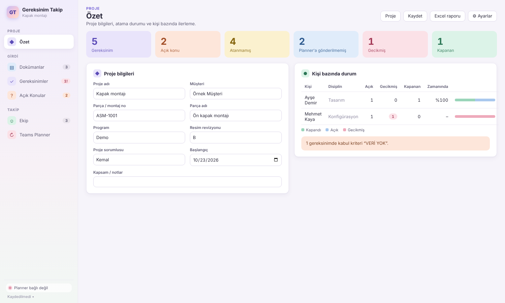

# Gereksinim Takip

Müşteri dokümanlarından (Word, Excel, PDF teknik resim, görsel, Outlook e-postası) gereksinim listesi ve açık konular çıkaran, her gereksinime kanıt yöntemi yazan, gereksinimleri tasarım / konfigürasyon / imalat mühendislerine miatla atayan ve atamaları **Teams Planner** ile senkron tutan masaüstü uygulaması.

Gereksinim ve açık konu mantığı FMEA Studio V4.6 ile aynıdır (REQ / ISS kimlikleri, "VERİ YOK – doğrulanmalı", kaynak gösterme, "AI Proposed" onay akışı); iki uygulama ileride bu kimlikler üzerinden bağlanacaktır.



## Kurulum (Windows)

1. GitHub’da **Releases** sayfasından son sürümün `Gereksinim-Takip-Kurulum-….exe` dosyasını indirin (ara derlemeler için **Actions → Build → Gereksinim-Takip-Windows**).
2. `Gereksinim-Takip-Kurulum-….exe` kurulum sihirbazıdır, `Gereksinim-Takip-Tasinabilir-….exe` kurulum gerektirmeden çalışır.
3. Uygulama kod imzalı olmadığı için SmartScreen “Bilinmeyen yayımcı” uyarısı gösterebilir: **Ek bilgi → Yine de çalıştır**.

### Güncellemeler

Kurulu sürüm, FMEA Studio’daki gibi kendini günceller: açılışta GitHub Releases’ta yeni sürüm olup olmadığına bakar, yalnızca değişen blokları indirir (blockmap) ve uygulama kapanırken kurar. İndirme bitince sağ altta **Şimdi yeniden başlat** düğmesi çıkar. Elle denetim: **Yardım → Güncellemeleri Denetle**.

- Güncelleyiciyi içeren ilk sürüm (0.2.0) bir kez tam kurulmalıdır; sonraki sürümler otomatik gelir.
- Taşınabilir sürüm kendini güncellemez.
- Yeni sürüm yayınlamak için `package.json` sürümünü artırıp main'e gönderin (veya `v<sürüm>` etiketi gönderin). CI o sürüm henüz yoksa `v<sürüm>` sürümünü açar ve kurulum dosyasını, `.blockmap` ve `latest.yml` dosyalarını yükler.
- Güncelleyici sürümleri anahtarsız okur; bu yüzden depo (veya sürümlerin yayınlandığı depo) herkese açık olmalıdır.

## Akış

| # | Ekran | Ne yapılır |
|---|---|---|
| 1 | Dokümanlar | Dosyaları yükleyin (çoklu seçim) veya e-posta metnini yapıştırın. Claude gereksinimleri, kanıt yöntemini, önerilen disiplini ve açık konuları çıkarır; önizlemede seçtikleriniz eklenir. |
| 2 | Gereksinimler | Kabul kriteri, **kanıt türü** (ölçüm, test, analiz, muayene, model kontrolü…) ve **kanıt** (beklenen rapor/kayıt). Satırları seçip **Ata** ile disiplin, sorumlu ve miat verin. |
| 3 | Açık Konular | Eksik bilgi, çelişki ve belirsizlikler (Critical / Important / Optional). Bunlar da atanabilir ve Planner’a gönderilebilir. |
| 4 | Ekip | Mühendisler ve Microsoft 365 e-posta adresleri. |
| 5 | Teams Planner | Bağlantı, plan seçimi, otomatik kontrol aralığı ve senkron günlüğü. |
| – | Özet | Sayaçlar ve kişi bazında açık / gecikmiş / zamanında kapanan oranı. |

Desteklenen dosyalar: `.docx`, `.xlsx`/`.xlsm`, `.pdf`, `.png`/`.jpg`, `.msg`, `.eml` (e-posta ekleri de okunur), `.txt`/`.csv`/`.md`/`.html`. Eski `.doc` / `.xls` biçimlerini önce yeni biçimde kaydedin.

## Teams Planner senkronu

İki yol vardır, Teams Planner ekranından seçilir:

- **Power Automate (varsayılan)**: Azure kaydı ve Premium lisans gerekmez. OneDrive/SharePoint ile senkron bir klasörde `giden` / `gelen` JSON dosyaları kullanılır. İki akışın kurulum tarifi: [docs/power-automate.md](docs/power-automate.md).
- **Doğrudan bağlantı (Graph)**: Azure uygulama kaydı gerekir. Anlık çalışır; Planner’da değişen miat ve görevin yeniden açılması da uygulamaya gelir. Ayrıntılar aşağıda.

### Graph modu

- **Planner’a gönder**: seçili her atama için plana görev açılır. Görev başlığı `REQ-012 · gereksinim metni`, miat Planner bitiş tarihi, sorumlu kişi görevin atananı olur. Her disiplin için bir kova (Tasarım, Konfigürasyon, İmalat) otomatik oluşturulur. Görev açıklamasına gereksinim, kabul kriteri, kanıt ve kaynak yazılır; sonuna bir ayraç çizgisi eklenir.
- Zaten gönderilmiş bir satırda miat, sorumlu, disiplin veya metin değişirse tekrar **Planner’a gönder** görevi günceller.
- **Kontrol** (uygulama açıkken her N dakikada bir veya “Şimdi kontrol et”):
  - Planner’da **tamamlanan** görev → satır “Kapandı” olur; kapanış tarihi, kapatan kişi ve açıklamadaki **ayraç çizgisinin altındaki metin** “Kapanış Açıklaması” alanına yazılır. Çizgi silinmişse açıklamanın tamamı alınır.
  - %50 → “Devam ediyor”; tamamlanmış görev yeniden açılırsa satır da açılır.
  - Planner’da değiştirilen miat uygulamaya alınır ve günlüğe yazılır.

### Azure uygulama kaydı (bir kez)

1. portal.azure.com → **Microsoft Entra ID → Uygulama kayıtları → Yeni kayıt** (yalnızca bu kuruluş).
2. **Kimlik doğrulama → Platform ekle → Mobil ve masaüstü uygulamaları**, yönlendirme URI’si `http://localhost`.
3. **API izinleri → Microsoft Graph → Temsilci izinleri**: `Tasks.ReadWrite`, `User.ReadBasic.All`. Kuruluş kullanıcı onayına izin vermiyorsa BT’den yönetici onayı isteyin.
4. Uygulama (istemci) ve Dizin (kiracı) kimliklerini Teams Planner ekranına girin, **Microsoft ile giriş yap**.

Giriş kişinin kendi hesabıyla yapılır (delegated); token işletim sisteminin şifreli deposunda saklanır. Yeni “Premium” Planner planları Graph üzerinden erişilemediği için standart (Teams ekibine bağlı) bir plan kullanın.

## Dosyalar

- Proje dosyası: `.greq` (JSON). Kayıt önce geçici dosyaya yazılıp sonra yeniden adlandırılır; ortak ağ klasöründe yarım dosya kalmaz.
- **Excel raporu**: Özet (kişi bazında), Gereksinimler, Açık Konular, Dokümanlar, Ekip, Planner Günlüğü.
- AI çıkarma **Claude Haiku** (`claude-haiku-5-5`) modeliyle yapılır ve dokümanları Anthropic API’sine gönderir; anahtar **Ayarlar**’dan girilir veya `ANTHROPIC_API_KEY` ortam değişkeni kullanılır.

## Geliştirme

```bash
npm install
npm run dev          # Vite + Electron
npm test             # Planner senkronu, dosya dönüştürme, özet, Excel testleri
npm run typecheck
npm run build && xvfb-run -a node tests/e2e/smoke.mjs ./shots   # uçtan uca duman testi
npm run dist:win     # Windows paketi (Windows veya CI)
```

Kod yapısı:

- `src/main/sources.ts`: Word / Excel / e-posta / PDF → Claude içerik blokları
- `src/main/ai.ts`: gereksinim + açık konu çıkarma (JSON şema)
- `src/main/graph.ts`: Microsoft Graph istemcisi ve giriş (MSAL)
- `src/shared/planner.ts`: Planner gönderme / kapanış çekme kuralları (ağdan bağımsız, testli)
- `src/shared/summary.ts`: kişi bazında özet (ileride tasarımcı KPI’ları)
- `src/renderer/`: React arayüzü (pastel tema: `styles.css`)

## Yol haritası

- ENOVIA’dan indirilen montaj / tek parça STEP dosyasını gereksinim listesiyle karşılaştırma raporu
- Tasarımcı KPI’ları
- FMEA Studio ile REQ / ISS bağlantısı
- Şirket ortak alanında çok kullanıcılı çalışma ve arka planda sürekli Planner senkronu
